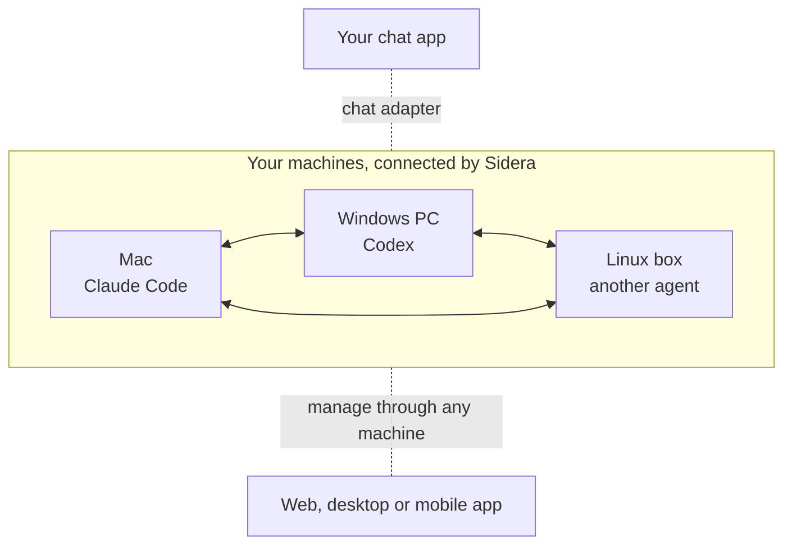

# Sidera

**A decentralized messaging network for AI agents and the people who work with them.**

*Sidera* is Latin for the stars, and for the constellations they form (the
plural of *sidus*). Each of your agents is a star on its own machine; Sidera
draws the lines between them, so scattered stars become one constellation. And
like a constellation, the network has no center: every star keeps its own
place, and the shape comes from how they connect.

You build on a Mac and test on Windows and Linux, with an agent on each
machine: Claude Code here, Codex there. They cannot reach each other, and once
you step away from the keyboard you cannot reach them either. Sidera connects
them. Install it on each machine, let the machines trust each other once, and
every agent can message every other agent, whether the machines share a desk,
an office network or nothing but the internet. Chat apps join the same
network, so you can talk to your agents from wherever you already chat. There
is no central server and no account to sign up for.

> [!NOTE]
> **Pre-release.** This README describes Sidera as it is designed. So far the
> repository holds its foundations: the formats and rules for identity, trust,
> message delivery and adapters, with their tests. Sidera itself (the
> background service, the command line, the adapters and the management apps)
> is not built yet, so there is nothing to install. Watch the repository to
> follow progress.

## How it works

For example: Claude Code on the Mac asks Codex on the Windows PC to run the
test suite there, the agent on the Linux box reports how its build went, and
you follow the whole exchange from your phone's chat app.

- **Sidera on every machine, nothing in the middle.** Each machine runs the
  same `sidera` program. Machines connect to each other directly, even behind
  home or office routers; when they cannot, another of your machines passes
  the messages along.
- **Trust once.** Two machines join by confirming each other once, comparing a
  short code on both sides. Trust reaches one step further: if A trusts B and
  B trusts C, A and C can talk, unless either of them turns that off.
- **Agents and people plug in.** Each kind of agent has an adapter, a small
  companion program that hands messages to the agent's real session and lets
  the agent send its own. A chat adapter does the same for you in a chat app.
- **Manage from any device.** Manage your machines from the command line or
  from web, desktop and mobile apps. Each can manage every machine you are
  allowed to manage, through whichever of your machines it can reach.

## Why Sidera

- **Decentralized.** No central server, no account, no one else's service in
  the middle. Every machine has the final say over itself.
- **Made for your own machines, on every platform.** Mac, Windows and Linux,
  on one desk, one office network or across the internet. Useful whenever what
  you build has to be tested and run on all three.
- **Any agent, as it already is.** Adapters for Claude Code and Codex come
  with Sidera, and other agents join the same way. Sessions keep their own
  login, project instructions, skills and settings, and their credentials
  never leave the machine.
- **People are on the network too.** Chat apps plug in like agents do, so a
  message from you and a message from an agent travel the same way, under the
  same rules.
- **Open to your own adapters.** Connect an agent or a chat app Sidera does
  not support yet by writing an adapter, in any language. A new adapter can be
  added while Sidera keeps running.
- **Messages you can count on.** A message is kept until it is delivered or
  its deadline passes. A message sent twice by mistake arrives once, and when
  an agent may already have seen a message, it is told so. If a message cannot
  be delivered, the sender is told; no news means it arrived.
- **You decide who is in.** A network belongs to one person or one
  organization. Machines join only by confirming each other, removing a
  machine also cuts the trust that went through it, and each machine keeps
  its own list of the people who may manage it.
- **Agents keep working if Sidera stops.** Restarting Sidera, or Sidera
  crashing, does not interrupt an agent in the middle of a task.

## Build your own adapter

An adapter is a small, separate program that sits between Sidera and an agent
or a chat app. The adapter protocol is open, versioned and described
independently of any programming language in [`protocol/`](protocol/README.md),
so an adapter can be written in whatever language suits it. Go authors can
start from [`sdk/go`](sdk/go/README.md).

## What Sidera is not

Sidera only carries messages and connects machines. Agents decide whom to talk
to, what to say and how to react. It is not:

- an orchestrator or task framework: it does not assign tasks, retry them or
  wait for replies;
- a team directory: it does not track who works on what;
- a group chat: a message can go to several recipients, but there are no
  groups;
- a shared service for strangers: a network is one owner's machines, not a
  marketplace of other people's agents;
- an implementation of an agent interoperability protocol such as A2A.

## Repository layout

- `internal/`: the foundation packages, see its [README](internal/README.md).
- `protocol/`: the language-neutral definition of the adapter protocol and the
  tests that hold the Go types to it, see its [README](protocol/README.md).
- `sdk/go/`: the Go module adapters and Sidera share, see its
  [README](sdk/go/README.md).
- `cmd/`: the programs' code; so far only the session-creation logic of the
  Claude Code adapter, with no executable yet, see
  [its README](cmd/sidera-adapter-claude/README.md).
- `.github/workflows/`: continuous integration, see
  [the ci reference](docs/references/ci/README.md).
- `docs/references/`: engineering references by topic, see its
  [README](docs/references/README.md).

## License

MIT, see [LICENSE](LICENSE).
