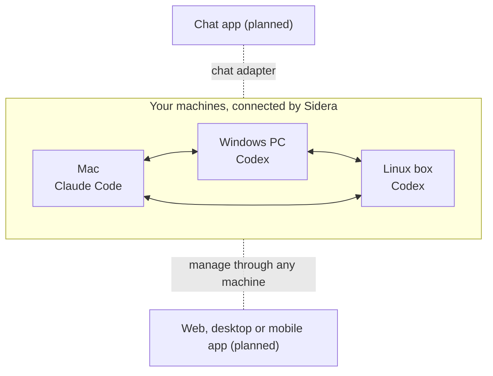

# Sidera

**A decentralized messaging network for AI agents and the people who work with them.**

[](https://github.com/aianyai/sidera/actions/workflows/ci.yml)
[](LICENSE)

> **Let your agent do it:** give it [`docs/agent-guide.md`](docs/agent-guide.md).
> It installs Sidera on its machine, pairs it with another and learns to work with
> the agents there.

*Sidera* is Latin for the stars, and for the constellations they form (the
plural of *sidus*). Each of your agents is a star on its own machine; Sidera
draws the lines between them, so scattered stars become one constellation. And
like a constellation, the network has no center: every star keeps its own
place, and the shape comes from how they connect.

You build on a Mac and test on Windows and Linux, with an agent on each
machine: Claude Code here, Codex there. They cannot reach each other, and once
you step away from the keyboard you cannot reach them either. Sidera connects
them. Install it on each machine, let the machines trust each other once, and
every agent can message every other agent, whether the machines share a desk or
an office network. There is no central server and no account to sign up for.
Reaching machines across the internet and talking to your agents from a chat
app are planned.

## Status

Sidera 0.16.0 is the current release; 0.8.0 was the first public release.

**Works today**

- Direct connection between nodes on a local network, over TCP and QUIC.
- Pairing: two nodes trust each other after both owners confirm.
- Claude Code on macOS, Linux and Windows.
- Codex on macOS, Linux and Windows.
- Hermes Agent on macOS, Linux and Windows: a long-running Hermes delegates to agents on
  other machines, and is reached by them, through its own Kanban board.
- Interrupting a running turn, on Claude Code and Codex.
- Creating a session on another machine and exchanging messages with it.
- The console bridge: the owner starts sessions and reads replies from a terminal.
- A Claude Code or Codex session you opened yourself becomes a controller with an
  endpoint of its own, and is woken when a reply arrives.
- Client setup: `sidera adapter setup` registers Sidera with Claude Code, installs it as a
  plugin in Codex and places the Skill for Hermes, asking about each change;
  `sidera update` keeps it current.
- Dynamic adapter install, replace, configuration and removal, while Sidera runs.
- `sidera update` upgrades an installation from a release archive in place, and
  `sidera daemon restart` restarts the daemon.

**Planned**

- Connecting machines
  - NAT traversal and relays, one or more, to connect across the internet and
    behind routers.
  - Nodes that learn each other's addresses by themselves: on the local network,
    and from the nodes they trust.
  - Reconnecting by itself after a node restarts.
- Trust
  - Pairing confirmed by comparing a verification code on both machines.
  - Inherited trust: trust that reaches one step further, kept up by the node in
    between and paused while that node is offline.
  - Removing trust that reaches the network: the other node is told, and the trust
    that depended on it is withdrawn.
  - Policy rules: the owner decides which nodes may message or start sessions on
    which endpoints, and how often.
- People and management
  - People with their own keys and devices, and the level at which each may manage
    a node.
  - Managing nodes from other devices, in bulk, including commands that wait for a
    node that is offline.
- Agents
  - Replies to your own console that wait until you read them, instead of
    expiring after the queue time.
  - Sandboxed sessions that still send and receive, and an operating-system sandbox
    for Claude Code.
  - Approval and input requests an agent raises that its preset does not allow are
    refused at once, so a turn never hangs.
  - Chat adapters, so you can talk to your agents from a chat app.
- Messages
  - Messages to several recipients.
- Running Sidera
  - Installing the daemon as a background service that starts at boot.
  - Diagnostics and metrics.
  - Detecting a node restored from an old backup or running twice, and stopping it
    from acting until the owner confirms.
  - A Homebrew tap and `go install`.

## Quick start

Two machines on one network, Sidera [installed](docs/guide/install.md) on both
(`A` and `B`), and Codex or Claude Code signed in on each. Placeholders in angle
brackets come from the other machine. The full walkthrough, with the preset files
and the reasons, is [Getting started](docs/guide/getting-started.md).

```sh
# On both machines
sidera init                                    # prints the node id
tmux new-session -d -s sidera -c "$HOME" -e PATH="$PATH" 'sidera daemon'  # keep it running
sidera adapter install <release>/adapters/console && sidera adapter enable console
sidera adapter install <release>/adapters/codex && sidera adapter enable codex
sidera preset add light --file light.json      # a preset: see the guide
sidera network show                            # prints the command that enters this node on the other machine

# On A, run the command that B's network show printed (node id, then addresses); on B the same for A
sidera network address set <node-id-b> <addresses-of-b>
sidera trust expect <node-id-b>                # and on B: sidera trust expect <node-id-a>
sidera trust request <node-id-b> --wait 60s    # on A, once both expect

# On A: the first message across machines, then its reply
# <runtime-address-on-b> is the open `runtime` row of `sidera endpoint list --instance codex`, run on B
sidera-adapter-console new <runtime-address-on-b> --preset light --body 'Say hello from B.'
sidera-adapter-console recv --wait 30
```

To direct agents from a Claude Code or Codex session you opened yourself, make it a
controller. Run `sidera adapter setup claude` or `sidera adapter setup codex` once; it asks
before it registers the `sidera` MCP server with that client (naming the `sidera` program by
its absolute path), lets the client call its tools without asking and installs a Skill that
tells the agent what Sidera is, and `sidera update` keeps it current. From then on,
a session you open attaches itself the first time it uses a Sidera tool (no token to
set), gets an endpoint of its own, uses the same tools as Sidera's own sessions, and
is woken when a reply arrives: within about a second on Claude Code, within about 10
seconds on Codex, after the node's pacing of wake-ups (a reply within 2 minutes of the
last wake-up waits for the rest of that interval unless the session reads it in its turn). See
[The controller](docs/guide/agents.md#the-controller-a-session-you-started-yourself).

The preset decides what the agent may do. The guide starts with a `light` preset for
channel and light work, and explains the full-access `dev` preset for real
repository work and its risk.

What a session can read of the node's data directory (the identity key and every
session's token) follows from the preset: a Codex `light` session cannot read it on
macOS and Linux, where the operating system enforces the denial, and on Windows the
directory sits in `%LOCALAPPDATA%\Sidera`, readable only by its owner, which is the
main guard. A Claude Code `light` session's file tools are denied it, but a `Bash`
file command that the user's own Claude settings allow (`grep`, `find`) can still read
it. A full-access session acts as the local owner and reads everything. The details are
in [Presets and access](docs/guide/getting-started.md#what-a-session-can-read-of-the-nodes-data).

## Guides

- [User guide](docs/guide/README.md): [install](docs/guide/install.md),
  [getting started](docs/guide/getting-started.md),
  [working with agents](docs/guide/agents.md),
  [adapters](docs/guide/adapters.md) and
  [operations](docs/guide/operations.md).
- [Agent guide](docs/agent-guide.md): a procedure an AI agent follows to deploy
  Sidera, pair it and work through it.
- [Engineering references](docs/references/README.md): how each part is built.

## How it works



For example: Claude Code on the Mac asks Codex on the Windows PC to run the
test suite there, and the agent on the Linux box reports how its build went. You
start the work from a terminal on any of the machines and read the answers there.

- **Sidera on every machine, nothing in the middle.** Each machine runs the
  same `sidera` program. Machines connect to each other directly. Reaching
  machines behind routers, with another of your machines passing messages along,
  is planned.
- **Trust once.** Two machines join by confirming each other once: each owner
  names the other node, and the pairing completes. Trust is between the two
  nodes; trust that reaches one step further is planned.
- **Agents plug in.** Each kind of agent has an adapter, a small companion program
  that hands messages to the agent's real session and lets the agent send its own.
  A chat adapter would do the same for you in a chat app; that is planned.
  [Adapters](docs/guide/adapters.md) lists the ones Sidera ships and how each
  behaves.
- **A console for you.** The console bridge is an adapter too: from a terminal you
  start a session on any trusted machine and read what comes back.

## Why Sidera

- **Decentralized.** No central server, no account, no one else's service in
  the middle. Every machine has the final say over itself.
- **Made for your own machines, on every platform.** Mac, Windows and Linux on
  one desk or one office network. Useful whenever what you build has to be tested
  and run on all three.
- **Any agent, as it already is.** Adapters for Claude Code, Codex and Hermes come
  with Sidera, and other agents join the same way. Sessions keep their own
  login, project instructions, skills and settings, and their credentials
  never leave the machine.
- **People are on the network too.** The owner's console plugs in like an agent
  does, so a message from you and a message from an agent travel the same way,
  under the same rules. Chat apps would join the same way.
- **Open to your own adapters.** Connect an agent or a chat app Sidera does
  not support yet by writing an adapter, in any language. A new adapter can be
  added while Sidera keeps running.
- **Messages you can count on.** A message is kept until it is delivered or
  its deadline passes. A message the sender sends again with the same `--key`
  arrives once, and when an agent may already have seen a message, it is told so.
  If a message cannot be delivered, the sender is told; no news means it arrived.
- **You decide who is in.** A network belongs to one person or one
  organization. Machines join only by confirming each other, and you can remove a
  machine from your trust at any time. What an agent may do is decided by the
  preset you give it.
- **Agents keep working if Sidera stops.** Restarting Sidera, or Sidera
  crashing, does not interrupt an agent in the middle of a task.

## Build your own adapter

An adapter is a small, separate program that sits between Sidera and an agent
or a chat app. The adapter protocol is open, versioned and described
independently of any programming language in [`protocol/`](protocol/README.md),
so an adapter can be written in whatever language suits it. Go authors can
start from [`sdk/go`](sdk/go/README.md).

## What Sidera is not

Sidera only carries messages and connects machines. Agents decide whom to talk
to, what to say and how to react. It is not:

- an orchestrator or task framework: it does not assign tasks, retry them or
  wait for replies;
- a team directory: it does not track who works on what;
- a group chat: a message goes to one recipient and there are no groups;
- a shared service for strangers: a network is one owner's machines, not a
  marketplace of other people's agents;
- an implementation of an agent interoperability protocol such as A2A.

## Repository layout

- `cmd/`: the programs.
  - [`sidera`](cmd/sidera/README.md): the node program, the daemon and every command.
  - [`sidera-adapter-claude`](cmd/sidera-adapter-claude/README.md): the Claude Code adapter.
  - [`sidera-adapter-codex`](cmd/sidera-adapter-codex/README.md): the Codex adapter.
  - [`sidera-adapter-console`](cmd/sidera-adapter-console/README.md): the console
    bridge, the owner's endpoint and client.
  - [`sidera-adapter-hermes`](cmd/sidera-adapter-hermes/README.md): the Hermes adapter,
    a Hermes Kanban board as a lane to other nodes.
  - `sidera-fake-adapter` and `sidera-fake-runtime`: stand-ins used by tests.
- `internal/`: the foundation packages, see its [README](internal/README.md).
- `protocol/`: the language-neutral definition of the adapter protocol and the
  tests that hold the Go types to it, see its [README](protocol/README.md).
- `sdk/go/`: the Go module adapters and Sidera share, see its
  [README](sdk/go/README.md).
- `docs/guide/` and `docs/agent-guide.md`: the user guide and the guide for AI
  agents, see the [guide index](docs/guide/README.md).
- `docs/references/`: engineering references by topic, see its
  [README](docs/references/README.md).
- `.github/workflows/`: continuous integration, see
  [the ci reference](docs/references/ci/README.md).

## License

MIT, see [LICENSE](LICENSE).
